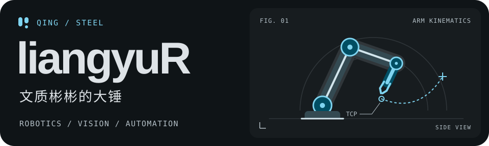

<picture>
  <source media="(prefers-color-scheme: light)" srcset="https://raw.githubusercontent.com/liangyuR/liangyuR/main/assets/profile-header-light.svg">
  
</picture>

白天让机械臂动起来，晚上写点自己想用的工具。从相机里找出目标，把位姿交给规划器，再去真机旁边看它到底怎么走。

## 工作台

**运动规划**　用 URDF 搭机械臂模型，在 RViz 里看 MoveIt 2 规划的轨迹，再上真机。

**机器视觉**　做手眼标定、目标检测和位姿估计，常用 OpenCV 和 YOLO。

**工程工具**　用 C++、Python 和 Qt，把反复要做的事写成工具。

## 精选项目

**[青钢 QING / STEEL](https://github.com/liangyuR/qing-steel)**

做胶路检测软件时，我想让人盯久了眼睛也舒服，又能一眼找到超差的那一段。青钢的深浅色阶、等宽读数和 OK / NG 判定卡都从这个需求而来。[打开交互演示 ↗](https://liangyur.github.io/qing-steel/demo/)

| 仓库 | 做了什么 |
| :--- | :--- |
| [Moveit-lab](https://github.com/liangyuR/Moveit-lab) | 用 ROS 2 和 MoveIt 2 规划机械臂轨迹，在 RViz 中查看避障路径。 |
| [train_yolo](https://github.com/liangyuR/train_yolo) | 给《坦克世界》画面做目标检测，用 YOLO 批量预标注，再到 CVAT 校对。 |
| [QtTsXlsxConverter](https://github.com/liangyuR/QtTsXlsxConverter) | 把 Qt 的多语言 `.ts` 翻译条目汇总到 Excel，逐项校对。 |

## 下班之后

写点游戏脚本，折腾 [Agent 的工具调用](https://github.com/liangyuR/Agent-learning-lab)，也骑车、旅行、发呆。

看看那条吃提交记录的蛇

<picture>
  <source media="(prefers-color-scheme: light)" srcset="https://raw.githubusercontent.com/liangyuR/liangyuR/output/snake-light.svg">
  
</picture>

机械臂能动，我不能。
